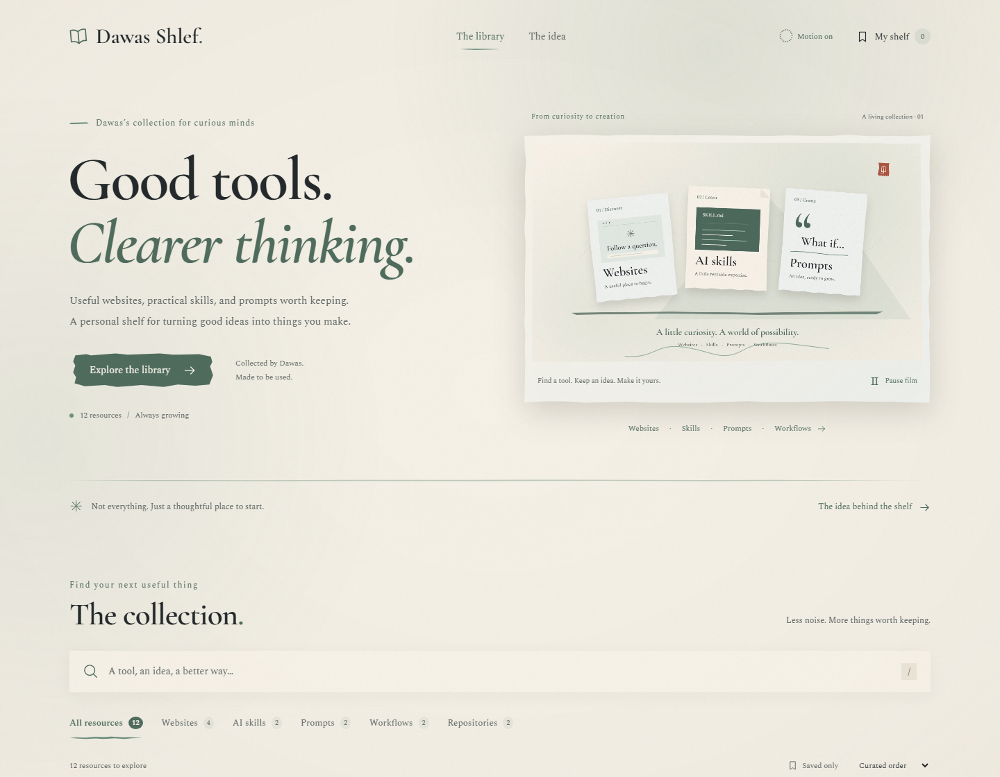

# Dawas Shlef

A personal AI resource library by Dawas: a place for followers to explore useful websites, reusable AI skills, practical prompts, workflows, and open-source repositories.

This repository contains the complete Astro website, editable Markdown resources, Anime.js motion, a ready-to-use hero video, and GitHub → Vercel configuration. The visual identity follows **Baduanjin — Tinta y Bruma**, using warm rice paper, celadon, ink strokes, and torn-paper surfaces.



The original design specification is preserved in [docs/DESIGN.md](docs/DESIGN.md).

## Technology

| Tool | Purpose |
| --- | --- |
| Astro 5 + TypeScript | Static pages, typed content, and reusable components |
| Markdown content collections | Resource entries and automatically generated detail pages |
| Anime.js 4 | Coordinated headline, card, SVG, and interaction animation |
| CSS + Fontsource | Responsive visual system and self-hosted typography |
| Playwright + axe | Desktop/mobile browser and automated accessibility checks |
| Vercel | Static hosting with deployments from GitHub |

## Quick workflows: Add & Ship

### 1. Add a new resource in 1 step
Run the interactive CLI wizard:
```sh
npm run add
```
It asks for the title, type (`website`, `skill`, `prompt`, `workflow`, `repository`), description, tags, source URL, and original author. The wizard validates the entry with the same schema Astro uses, creates its Markdown file in `src/content/resources/`, and runs the project check. Invalid input creates no file; a failed project check removes only the new entry and returns an error.

Or specify options directly via command-line flags:
```sh
node tools/add-resource.mjs --title "Bolt.new" --type website --url "https://bolt.new" --desc "In-browser AI web sandbox" --tags "Builder,Code,Web"
```

For a real skill, import its complete instructions rather than generating placeholder skill content:

```sh
node tools/add-resource.mjs --title "My skill" --type skill --desc "What this skill helps with" --tags "Planning,Agents" --author "Original author" --copy-file "./path/to/SKILL.md"
```

Prompts also require actual text through `--copy-file` or `--copy-text`. Skill dependencies and supporting files must still be reviewed and supplied separately; importing a wrapper such as Grill Me does not import Grilling automatically. The source file is read without changing it. Source URLs and author information are entered explicitly.

Other options include `--slug`, `--art`, `--copyLabel`, `--compatibility`, and `--steps "First step;Second step"`. Use `node tools/add-resource.mjs --help` for a quick reference. Missing URL schemes receive HTTPS; existing HTTP or other unsupported schemes are rejected instead of rewritten into a broken address. Titles that cannot produce an English URL slug need an explicit `--slug`.

You can also copy starter templates from `templates/` into `src/content/resources/`, including category subfolders. Replace the example content, dates, authors, and copyable instructions before publishing. Underscore-prefixed files such as `_draft.md` are excluded by the content loader. The wizard leaves editorial guidance in the body for you to finish; passing validation does not mean that the editorial content is complete.

### 2. Ship to GitHub and Vercel in 1 step
```sh
npm run ship
```
This command:
1. Fetches the current remote branch and stops if newer remote work must be integrated.
2. Runs `npm run test:tools`, `npm run check`, and `npm run build`.
3. Lists, stages, and commits all unignored changes with a custom or default commit message.
4. Pushes the **current branch** to GitHub using literal Git arguments, so quotation marks and shell characters in the message are preserved.

You can supply a message with `npm run ship -- "Add a new resource"`. A synchronized, clean branch is a no-op; already committed local changes can still be pushed. Failed validation stops before staging, committing, or pushing. The script does not force-push or merge remote work automatically.

After the push, GitHub Actions runs its checks. If this repository is connected to Vercel, Vercel can start a deployment. A successful push does **not** confirm deployment success: check the Vercel dashboard for the result. Production updates come from the configured production branch, usually `main`; other branches can create previews. There is no guaranteed deployment duration.

## Run locally

Use Node.js 22.12 or newer (Node 24 is supported).

```sh
git clone https://github.com/DAWAS00/Dawas-Shelf.git
cd Dawas-Shelf
npm ci
npm run dev
```

Open the local address printed by Astro, normally `http://127.0.0.1:4321`.

```sh
npm run check
npm run build
npm run preview
```

Astro builds the website to `dist/`. There is no database, account system, API key, or server to configure. Fonts are bundled locally, with no Google Fonts requests.

## What is included

- Home, full resource library, about page, custom 404, and generated detail pages.
- Thirteen editable starter entries: five websites, two skills, two prompts, two workflows, and two repositories.
- Search across titles, descriptions, types, and tags; category filters; sorting; URL-restored filter state; and a useful empty state.
- My shelf bookmarks stored on the visitor’s device. If browser storage is blocked, the current page keeps a temporary shelf and explains the limitation.
- Full prompt and skill copy buttons, a manual selection fallback, workflow instructions, source attribution, and related resources.
- Enlarged accessible previews with focus management and Escape-to-close.
- Static HTML remains readable without JavaScript. Search, saving, copying, and preview enlargement require JavaScript.

The seed collection is sample editorial content, ready to replace with your own resources and personal notes. Website previews are labeled editorial illustrations; the collection also supports real screenshots.

## Pages

| Address | What visitors can do |
| --- | --- |
| `/` | Watch the hero film and browse the collection |
| `/resources/` | Search, filter, sort, and save resources |
| `/resources/<resource-id>/` | Read an entry, view its preview, follow instructions, and copy prompts or skills |
| `/resources/?saved=1` | See resources saved in this browser |
| `/about/` | Read about the idea behind the library |

Saved resources stay on the visitor’s device. There is no login or cross-device synchronization.

## Edit the collection

Add or edit a Markdown file in `src/content/resources/`. Its filename becomes the page address. Content is validated by `src/content.config.ts`, and all pages are generated automatically.

```yaml
---
title: My useful website
type: website
description: A short explanation of what makes this resource useful.
tags: [Research, Writing]
updated: 2026-11-02
order: 13
url: https://example.com/
author: Original author or project
art: research
---

## What it does

Explain it in plain language.

## Why I use it

Add your own experience and a practical example.
```

Supported types are `website`, `skill`, `prompt`, `workflow`, and `repository`. Use `order` to set curated order. A lower value appears first. `updated` is the date the library entry changed; it does not represent the external product’s release date.

For a prompt or skill, add `copyText: |` followed by the indented complete text, plus an optional `copyLabel`. Skills should include a useful `compatibility` note. Workflows and skills can include a `steps` list. `tutorialUrl` adds a tutorial link when you have one. All external URLs must use HTTPS.

### Add a real website screenshot

Place a screenshot you have permission to use in `public/previews/`, then add:

```yaml
preview: /previews/my-website.webp
previewAlt: Homepage showing the main research input and navigation.
previewKind: screenshot
```

Prefer a compressed image around 1200px wide. Cards crop to a consistent ratio; the detail page and enlarged preview show the whole image. When no image is supplied, the site uses a labeled illustration. Choose `art: research`, `code`, `prompt`, `skill`, `workflow`, or `repository` for that illustration.

Previews are saved images or editorial illustrations, rather than third-party iframes. There is no external screenshot service or tracking dependency.

## Visual system

`src/styles/global.css` contains the design tokens. Exact palette:

| Purpose | Color |
| --- | --- |
| Paper | `#f5f1e7` |
| Ink | `#23282a` |
| Celadon, graphic accents | `#6d8f7d` |
| Deep celadon, text and primary actions | `#4e6b5c` |
| Cinnabar, intro seal only | `#a44a3f` |

The display stack is `'Cormorant Garamond', 'Ma Shan Zheng', 'Noto Serif TC', serif`; the body stack is `'Spectral', 'Noto Serif TC', serif`. Required weights are self-hosted through Fontsource, including Noto Serif TC 400/700/900 and its Unicode-range subsets. Cormorant 600 italic is also supplied for editorial emphasis.

Seeded torn-paper edges are stable and unique per resource. The paper layer is clipped separately from text and focus rings. Borderless controls use brush shapes or ink strokes. Ink, ink-light, and deep celadon carry readable text; ordinary celadon is reserved for graphics. Forced-colors support retains focus and selected-state cues.

### Animation and hero film

Anime.js 4 orchestrates clipped headline reveals, overlapping timelines, SVG ink-path drawing, staggered card entrances, filter results, preview hover movement, and small save/copy responses. The implementation uses Anime.js directly in Astro; it does not need React. Text remains opaque throughout movement to retain its contrast. GPU hints are used during card and headline movement, then cleared. Motion scopes are reverted when disabled or when the page leaves.

The header’s motion switch stops page animation and automatic video playback, and remembers the choice. Device reduced-motion settings take priority. There is no smooth scrolling or automatic video loading with reduced motion; a static WebP poster remains. Visitors can explicitly play the silent hero film with its separate playback control. Data Saver also prevents automatic video loading. Playback pauses outside the viewport and when the page is hidden. A manual pause is preserved during those visibility changes.

`public/media/shelf-hero.mp4` is an original, locally rendered eight-second, 1280×720, 24fps H.264 motion-graphics loop, with no audio track. It depicts website, skill, and prompt cards above an ink-brush shelf. It uses the site palette and self-hosted fonts, and is approximately 0.77 MB. The video and static WebP poster are included in the repository.

To regenerate the film, install a local FFmpeg executable, run `npx playwright install chromium`, and run `npm run render:hero`. The editable drawing source is `tools/render-hero.mjs`; normal builds use the included media and do not require FFmpeg or a browser.

No newsletter form, analytics, or social links are included until real destinations exist. Personalize the name and introductory copy in the components and pages under `src/`.

## Community contributions

The contribution form collects websites, skills, prompts, workflows, and repositories for private manual review. Its protected delivery path is `POST /api/contributions`, a Vercel Node function with server validation, Cloudflare Turnstile verification, atomic Upstash Redis limits, duplicate suppression, and private plain-text email through Resend.

The implementation is local and **closed until configured**. Activate it using [the security and setup guide](docs/CONTRIBUTION-SECURITY.md) and `.env.example`. The former Formspree endpoint must be disabled in its dashboard to close the old direct submission route. No API keys or inbox addresses belong in browser code or Git.

For accepted suggestions, use `npm run add` and the normal review/publishing workflow. Submissions cannot execute skills or publish content. Private contact details must never enter public resource files.

## GitHub → Vercel

1. In Vercel, create a project and import [`DAWAS00/Dawas-Shelf`](https://github.com/DAWAS00/Dawas-Shelf).
2. Use the repository root as the **Root Directory** and select the **Astro** framework preset.
3. Set Node.js to **24**, install with `npm ci`, build with `npm run build`, and publish `dist`. `vercel.json` includes the framework, build command, and output directory.
4. Deploy. Once connected, commits to `main` trigger production deployments; other branches can receive preview deployments.

The library stays static and needs no Vercel adapter. Protected contributions require the server-side environment variables and public CAPTCHA site key in `.env.example`. The GitHub integration must be connected in Vercel once; this source upload does not create a new Vercel project.

For later content updates, edit a file in `src/content/resources/`, run the local checks, and push your commit. GitHub stores the source, and the connected Vercel project rebuilds the website from it.

Astro static deployment needs no Vercel adapter. See the official [Astro on Vercel guide](https://vercel.com/docs/frameworks/frontend/astro) and [Astro content collection guide](https://docs.astro.build/en/guides/content-collections/).

## Browser checks

```sh
npx playwright install chromium
npm run test:tools
npm run build
npm test
```

Playwright checks desktop and mobile search/filter combinations, bookmark persistence, blocked storage, exact copy payloads, copy failure, modal keyboard behavior, reduced motion, no-JavaScript content, horizontal overflow, and WCAG A/AA checks through axe. It also checks the new name, real video playback, manual pause, off-screen pause, the saved motion switch, and Data Saver. Tests run against the static production preview. Automated checks supplement visual and keyboard review; they are not a complete accessibility certification.

The included GitHub Actions workflow runs the resource/publishing regression tests, type checks, production build, and browser tests on pushes and pull requests. Tool tests use temporary local repositories and never push to GitHub. Browser tests use Astro's rendered inventory rather than independently counting Markdown files, so nested resources and excluded drafts follow the actual loader. See [VALIDATION.md](VALIDATION.md) for the verification record.

## Files to know

```text
docs/DESIGN.md                 Original visual specification
src/content/resources/*.md    Resource content
src/content.config.ts         Validated content fields
src/lib/resource-schema.mjs   Shared Astro and wizard validation
src/components/               Reusable paper, brush, preview, and library pieces
src/layouts/Base.astro        Fonts, metadata, navigation, footer
src/pages/                    Homepage, library, detail pages, about, contribute, 404
src/scripts/                  Library controls, contributions, Anime.js motion, video playback
src/lib/contributions.ts      Internal contribution API path
src/styles/global.css         Exact tokens and responsive layouts
public/previews/              Your website screenshots
public/media/                 Ready-to-use hero film and static poster
tools/render-hero.mjs         Editable local motion-graphics renderer
tools/add-resource.mjs        Resource wizard and text-file importer
tools/ship.mjs                Checked commit and current-branch push workflow
templates/                    Editable starter resource files
tests/                        Browser and accessibility checks
vercel.json                   Static Vercel settings
```
